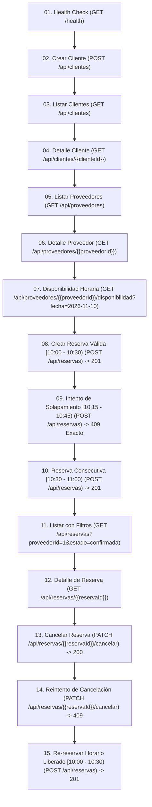

# Sistema de Reservas de Citas y Turnos - API REST Profesional

API REST robusta, modular y de alto rendimiento desarrollada en **Node.js** y **Express** con persistencia en **SQLite** mediante `better-sqlite3`. Diseñada para gestionar agendas, turnos y citas en sectores como peluquerías, consultorios médicos, canchas deportivas y servicios bajo reserva horaria.

---

## 1. Arquitectura y Tecnologías

### Stack Tecnológico
- **Entorno de Ejecución:** Node.js (Versión mínima compatible: **`>= 18.0.0`**, probado en Node.js v24.x).
- **Framework Web:** Express 5.x.
- **Base de Datos:** SQLite 3 mediante `better-sqlite3` con modo **WAL (Write-Ahead Logging)**, claves foráneas estrictas (`PRAGMA foreign_keys = ON`) y transacciones atómicas `IMMEDIATE`.
- **Manejo de Fechas y Zonas Horarias:** `luxon` con soporte completo para instantes ISO 8601 y husos horarios IANA (`America/Bogota` por defecto).
- **Seguridad y Utilidades:** `cors`, `dotenv`.
- **Pruebas Automatizadas:** Módulo nativo `node:test`, `node:assert/strict` y `supertest`.

### Estructura del Proyecto
```text
Prueba.Api/
├── data/
│   └── reservas.db           # Archivo persistente SQLite (creado automáticamente)
├── src/
│   ├── app.js                # Ensamblado de Express, middlewares y factoría de app
│   ├── server.js             # Inicialización del servidor HTTP y graceful shutdown
│   ├── config/
│   │   └── env.js            # Carga y validación de variables de entorno
│   ├── database/
│   │   ├── connection.js     # Pool/conexión optimizada a SQLite (WAL, timeouts, FKs)
│   │   ├── schema.js         # DDL de tablas, claves foráneas, checks e índices
│   │   └── seed.js           # Población reproducible e idempotente de datos iniciales
│   ├── utils/
│   │   ├── dateUtils.js      # Parseo ISO 8601, conversiones UTC y validación de horarios
│   │   └── errors.js         # Clases de error (AppError, ScheduleConflictError, etc.)
│   ├── validators/
│   │   ├── clienteValidator.js   # Validaciones para clientes y IDs
│   │   ├── proveedorValidator.js # Validaciones para proveedores y fechas
│   │   └── reservaValidator.js   # Validaciones de reservas y filtros estrictos
│   ├── repositories/
│   │   ├── clienteRepository.js   # Consultas e inserciones de clientes
│   │   ├── proveedorRepository.js # Consultas de proveedores activos
│   │   └── reservaRepository.js   # Transacciones atómicas y prevención de solapamientos
│   ├── services/
│   │   ├── clienteService.js      # Lógica de clientes y unicidad de email
│   │   ├── proveedorService.js    # Lógica de proveedores y cálculo de disponibilidad
│   │   └── reservaService.js      # Lógica de reservas y orquestación de negocio
│   ├── controllers/
│   │   ├── clienteController.js   # Manejadores de rutas de clientes
│   │   ├── proveedorController.js # Manejadores de rutas de proveedores
│   │   └── reservaController.js   # Manejadores de rutas de reservas
│   ├── middlewares/
│   │   ├── errorHandler.js        # Middleware centralizado de errores (HTTP 400, 404, 409, 500)
│   │   └── notFoundHandler.js     # Manejador de rutas no encontradas (HTTP 404)
│   └── routes/
│       ├── index.js               # Enrutador principal /api
│       ├── clienteRoutes.js       # Rutas /api/clientes
│       ├── proveedorRoutes.js     # Rutas /api/proveedores
│       └── reservaRoutes.js       # Rutas /api/reservas
├── tests/
│   └── reservas.test.js      # 16 pruebas automatizadas obligatorias (base de datos en memoria)
├── .env                      # Configuración de entorno local
├── .env.example              # Plantilla de variables de entorno
├── .gitignore                # Reglas para git
├── package.json              # Dependencias, scripts y metadatos
├── postman_collection.json   # Colección Postman v2.1 lista para importar
└── README.md                 # Documentación técnica completa
```

---

## 2. Instalación y Ejecución Rápida

### Requisitos Previos
- **Node.js**: versión 18.0.0 o superior (`node -v`).
- **NPM**: versión 9.0.0 o superior (`npm -v`).

### Comandos de Inicialización

1. **Instalar dependencias:**
   ```bash
   npm install
   ```

2. **Configurar variables de entorno:**
   Copie el archivo `.env.example` a `.env` si no existe:
   ```bash
   cp .env.example .env
   ```

3. **Poblar la base de datos con datos de prueba reproducibles:**
   ```bash
   npm run seed
   ```

4. **Ejecutar el servidor en modo desarrollo:**
   ```bash
   npm run dev
   ```
   O en producción:
   ```bash
   npm start
   ```

5. **Ejecutar la suite completa de pruebas automatizadas (16 casos):**
   ```bash
   npm test
   ```

---

## 3. Modelo de Datos y Esquema Relacional

### Entidades

#### 1. `clientes`
| Campo | Tipo | Restricciones | Descripción |
|---|---|---|---|
| `id` | INTEGER | PRIMARY KEY AUTOINCREMENT | Identificador único del cliente |
| `nombre` | TEXT | NOT NULL | Nombre completo |
| `email` | TEXT | NOT NULL UNIQUE COLLATE NOCASE | Correo electrónico único |
| `telefono` | TEXT | NULL | Teléfono de contacto (opcional) |
| `createdAt` | TEXT | NOT NULL DEFAULT ISO 8601 UTC | Fecha de creación del registro |

#### 2. `proveedores`
| Campo | Tipo | Restricciones | Descripción |
|---|---|---|---|
| `id` | INTEGER | PRIMARY KEY AUTOINCREMENT | Identificador del proveedor o servicio |
| `nombre` | TEXT | NOT NULL | Nombre del proveedor/cancha/profesional |
| `tipo` | TEXT | NOT NULL | Categoría (Salud, Estética, Deportes, etc.) |
| `duracionMinutos` | INTEGER | NOT NULL, CHECK (> 0) | Duración predeterminada del turno |
| `horaApertura` | TEXT | NOT NULL | Formato HH:MM (ej. "08:00") |
| `horaCierre` | TEXT | NOT NULL | Formato HH:MM (ej. "18:00") |
| `diasAtencion` | TEXT | NOT NULL | Días que labora (ej. "1,2,3,4,5" donde 1=Lun .. 7=Dom) |
| `activo` | INTEGER | NOT NULL DEFAULT 1 CHECK (0 o 1) | Indica si acepta reservas |
| `createdAt` | TEXT | NOT NULL DEFAULT ISO 8601 UTC | Fecha de registro |

#### 3. `reservas`
| Campo | Tipo | Restricciones | Descripción |
|---|---|---|---|
| `id` | INTEGER | PRIMARY KEY AUTOINCREMENT | Identificador único de la cita/reserva |
| `clienteId` | INTEGER | NOT NULL, FK -> clientes(id) | Cliente que reserva |
| `proveedorId` | INTEGER | NOT NULL, FK -> proveedores(id) | Proveedor asignado |
| `fechaHoraInicio` | TEXT | NOT NULL | Timestamp ISO 8601 UTC normalizado |
| `fechaHoraFin` | TEXT | NOT NULL | Timestamp ISO 8601 UTC calculado |
| `estado` | TEXT | NOT NULL CHECK ('confirmada', 'cancelada') | Estado de la reserva |
| `createdAt` | TEXT | NOT NULL DEFAULT ISO 8601 UTC | Fecha de creación |

---

## 4. Regla Crítica: Prevención de Solapamientos y Concurrencia

### Condición Matemática y Algorítmica
Dos intervalos de reserva `[inicioA, finA)` e `[inicioB, finB)` para el mismo proveedor entran en conflicto si y solo si:
$$\text{nuevaInicio} < \text{existenteFin} \quad \land \quad \text{nuevaFin} > \text{existenteInicio}$$

- Los intervalos son **semiabiertos a la derecha: $[inicio, fin)$**. Por tanto, una cita que finaliza a las `10:30` permite exactamente otra cita que inicie a las `10:30` (reserva consecutiva válida).
- **Únicamente las reservas con `estado = 'confirmada'` generan bloqueo.** Si una reserva previa se cancela, su horario queda inmediatamente liberado.

### Garantía de Atomicidad ante Solicitudes Simultáneas
En `better-sqlite3`, las transacciones se inician de forma inmediata mediante `transaction.immediate(...)`, lo cual ejecuta:
```sql
BEGIN IMMEDIATE;
```
Esto adquiere de inmediato el bloqueo reservado de escritura en el motor SQLite antes de leer o escribir. De este modo, la consulta de solapamiento y la posterior inserción se ejecutan dentro del **mismo ciclo síncrono atómico**:
1. Comprueba si existe alguna reserva confirmada con solapamiento:
   ```sql
   SELECT id FROM reservas 
   WHERE proveedorId = ? 
     AND estado = 'confirmada' 
     AND fechaHoraInicio < ? 
     AND fechaHoraFin > ? 
   LIMIT 1;
   ```
2. Si existe solapamiento, se revierte la transacción y se responde **estrictamente** con HTTP 409:
   ```json
   {
     "error": "Conflicto de horario",
     "detalle": "El proveedor ya tiene una reserva en el intervalo solicitado."
   }
   ```
3. Si no existe solapamiento, se inserta la reserva y se confirma la transacción.

Si dos solicitudes concurrentes intentan reservar el mismo horario, la serialización atómica garantiza que la primera se confirma (201) y la segunda es rechazada con 409 y el JSON exacto.

---

## 5. Estrategia de Fechas, Horas y Zona Horaria

1. **Almacenamiento en Base de Datos:**
   Todos los instantes (`fechaHoraInicio`, `fechaHoraFin`) se normalizan y almacenan en cadenas **ISO 8601 UTC** completas:
   `YYYY-MM-DDTHH:mm:ss.sssZ` (por ejemplo, `2026-11-10T15:00:00.000Z`).
   En SQLite, las cadenas ISO UTC mantienen una equivalencia directa con el orden temporal lexicográfico (`<`, `>`, `<=`, `>=`).

2. **Entrada de Datos desde Postman o Clientes:**
   Se pueden enviar instantes en formato ISO 8601 con offset local o UTC:
   - Con offset: `"2026-11-10T10:00:00-05:00"`
   - En UTC: `"2026-11-10T15:00:00Z"`

3. **Zona Horaria del Negocio (`TIMEZONE`):**
   Configurable vía variable de entorno (por defecto `America/Bogota`). Se utiliza para determinar la hora local del día y verificar que el turno solicitado se encuentre dentro de `horaApertura`, `horaCierre` y `diasAtencion` del proveedor.

---

## 6. Endpoints de la API

### Clientes

| Método | Ruta | Descripción | Respuestas |
|---|---|---|---|
| `POST` | `/api/clientes` | Registra un nuevo cliente | `201 Created`, `400 Bad Request`, `409 Conflict` (email duplicado) |
| `GET` | `/api/clientes` | Lista todos los clientes | `200 OK` |
| `GET` | `/api/clientes/:id` | Obtiene un cliente por ID | `200 OK`, `404 Not Found` |
| `PUT` | `/api/clientes/:id` | Actualiza la información de un cliente | `200 OK`, `400 Bad Request`, `404 Not Found`, `409 Conflict` (email duplicado) |
| `DELETE` | `/api/clientes/:id` | Elimina un cliente de la base de datos | `200 OK`, `404 Not Found`, `409 Conflict` (si tiene reservas asociadas) |

### Proveedores

| Método | Ruta | Descripción | Respuestas |
|---|---|---|---|
| `GET` | `/api/proveedores` | Lista los proveedores activos | `200 OK` |
| `GET` | `/api/proveedores/:id` | Detalle del proveedor | `200 OK`, `404 Not Found` |
| `GET` | `/api/proveedores/:id/disponibilidad?fecha=YYYY-MM-DD` | Turnos libres disponibles para una fecha | `200 OK`, `400 Bad Request`, `404 Not Found` |

### Reservas

| Método | Ruta | Descripción | Respuestas |
|---|---|---|---|
| `POST` | `/api/reservas` | Crea una reserva (calcula `fechaHoraFin`) | `201 Created`, `400 Bad Request`, `404 Not Found`, `409 Conflict` (solapamiento) |
| `GET` | `/api/reservas` | Lista reservas con filtros opcionales | `200 OK`, `400 Bad Request` (filtros inválidos) |
| `GET` | `/api/reservas/:id` | Detalle de una reserva | `200 OK`, `404 Not Found` |
| `PATCH` | `/api/reservas/:id/cancelar` | Cancela una reserva confirmada | `200 OK`, `404 Not Found`, `409 Conflict` (ya cancelada) |
| `DELETE` | `/api/reservas/:id` | Elimina permanentemente una reserva | `200 OK`, `404 Not Found` |


---

## 7. Guía Completa de Pruebas con Postman

### Configuración Inicial en Postman
1. Abra Postman.
2. Haga clic en **Import** y seleccione el archivo [postman_collection.json](file:///c:/Users/juancho/Documents/Prueba.Api/postman_collection.json).
3. Verifique que la variable de colección `baseUrl` tenga el valor:
   `http://localhost:3000`

### Orden Recomendado de Ejecución



### Detalle Paso a Paso de las Solicitudes

#### Paso 1: Health Check
- **Método:** `GET`
- **URL:** `{{baseUrl}}/health`
- **Código esperado:** `200 OK`
- **Respuesta esperada:**
  ```json
  {
    "status": "ok",
    "service": "sistema-reservas-citas-api",
    "uptime": 12.34,
    "timestamp": "2026-10-16T15:50:00.000Z"
  }
  ```

#### Paso 2: Crear Nuevo Cliente
- **Método:** `POST`
- **URL:** `{{baseUrl}}/api/clientes`
- **Headers:** `Content-Type: application/json`
- **Body JSON:**
  ```json
  {
    "nombre": "Valentina Mendoza",
    "email": "valentina.mendoza@email.com",
    "telefono": "+573151234567"
  }
  ```
- **Código esperado:** `201 Created`
- **Script Postman:** Almacena automáticamente `jsonData.id` en `{{clienteId}}`.

#### Paso 3: Listar Clientes
- **Método:** `GET`
- **URL:** `{{baseUrl}}/api/clientes`
- **Código esperado:** `200 OK`

#### Paso 4: Obtener Cliente por ID
- **Método:** `GET`
- **URL:** `{{baseUrl}}/api/clientes/{{clienteId}}`
- **Código esperado:** `200 OK`

#### Paso 5: Listar Proveedores Activos
- **Método:** `GET`
- **URL:** `{{baseUrl}}/api/proveedores`
- **Código esperado:** `200 OK`
- **Script Postman:** Almacena `jsonData[0].id` en `{{proveedorId}}`.

#### Paso 6: Detalle del Proveedor
- **Método:** `GET`
- **URL:** `{{baseUrl}}/api/proveedores/{{proveedorId}}`
- **Código esperado:** `200 OK`

#### Paso 7: Consultar Disponibilidad
- **Método:** `GET`
- **URL:** `{{baseUrl}}/api/proveedores/{{proveedorId}}/disponibilidad?fecha=2026-11-10`
- **Código esperado:** `200 OK`
- **Respuesta esperada:**
  ```json
  {
    "fecha": "2026-11-10",
    "zonaHoraria": "America/Bogota",
    "proveedor": {
      "id": 1,
      "nombre": "Dra. Sofía Martínez - Consulta General",
      "tipo": "Salud",
      "duracionMinutos": 30,
      "horaApertura": "08:00",
      "horaCierre": "17:00",
      "diasAtencion": [1, 2, 3, 4, 5]
    },
    "intervalosDisponibles": [
      {
        "inicio": "2026-11-10T08:00:00.000-05:00",
        "fin": "2026-11-10T08:30:00.000-05:00",
        "inicioUtc": "2026-11-10T13:00:00.000Z",
        "finUtc": "2026-11-10T13:30:00.000Z"
      }
    ]
  }
  ```

#### Paso 8: Crear Reserva Confirmada Válida
- **Método:** `POST`
- **URL:** `{{baseUrl}}/api/reservas`
- **Headers:** `Content-Type: application/json`
- **Body JSON:**
  ```json
  {
    "clienteId": 1,
    "proveedorId": 1,
    "fechaHoraInicio": "2026-11-10T10:00:00-05:00",
    "duracionMinutos": 30
  }
  ```
- **Código esperado:** `201 Created`
- **Respuesta esperada:**
  ```json
  {
    "id": 1,
    "clienteId": 1,
    "clienteNombre": "Carlos Gómez",
    "clienteEmail": "carlos.gomez@email.com",
    "clienteTelefono": "+573001112233",
    "proveedorId": 1,
    "proveedorNombre": "Dra. Sofía Martínez - Consulta General",
    "proveedorTipo": "Salud",
    "fechaHoraInicio": "2026-11-10T15:00:00.000Z",
    "fechaHoraFin": "2026-11-10T15:30:00.000Z",
    "estado": "confirmada",
    "createdAt": "2026-10-16T15:52:00.000Z"
  }
  ```
- **Script Postman:** Almacena `jsonData.id` en `{{reservaId}}`.

#### Paso 9: Intento de Reserva Solapada (Caso Crítico de Conflicto)
- **Método:** `POST`
- **URL:** `{{baseUrl}}/api/reservas`
- **Headers:** `Content-Type: application/json`
- **Body JSON:**
  ```json
  {
    "clienteId": 2,
    "proveedorId": 1,
    "fechaHoraInicio": "2026-11-10T10:15:00-05:00",
    "duracionMinutos": 30
  }
  ```
- **Código esperado:** `409 Conflict`
- **Cuerpo JSON estricto esperado:**
  ```json
  {
    "error": "Conflicto de horario",
    "detalle": "El proveedor ya tiene una reserva en el intervalo solicitado."
  }
  ```

#### Paso 10: Reserva Consecutiva Adyacente (Sin Solapamiento)
- **Método:** `POST`
- **URL:** `{{baseUrl}}/api/reservas`
- **Headers:** `Content-Type: application/json`
- **Body JSON:**
  ```json
  {
    "clienteId": 2,
    "proveedorId": 1,
    "fechaHoraInicio": "2026-11-10T10:30:00-05:00",
    "duracionMinutos": 30
  }
  ```
- **Código esperado:** `201 Created` (Permitida porque inicia exactamente al terminar la anterior).

#### Paso 11: Listar Reservas con Filtros
- **Método:** `GET`
- **URL:** `{{baseUrl}}/api/reservas?proveedorId=1&estado=confirmada`
- **Código esperado:** `200 OK`

#### Paso 12: Consultar Reserva por ID
- **Método:** `GET`
- **URL:** `{{baseUrl}}/api/reservas/{{reservaId}}`
- **Código esperado:** `200 OK`

#### Paso 13: Cancelar Reserva
- **Método:** `PATCH`
- **URL:** `{{baseUrl}}/api/reservas/{{reservaId}}/cancelar`
- **Código esperado:** `200 OK`
- **Respuesta esperada:**
  ```json
  {
    "id": 1,
    "estado": "cancelada"
  }
  ```

#### Paso 14: Reintento de Cancelación (Conflicto de Estado)
- **Método:** `PATCH`
- **URL:** `{{baseUrl}}/api/reservas/{{reservaId}}/cancelar`
- **Código esperado:** `409 Conflict`
- **Respuesta esperada:**
  ```json
  {
    "error": "Conflicto de estado",
    "detalle": "La reserva ya se encuentra cancelada."
  }
  ```

#### Paso 15: Crear Nueva Reserva en Horario Liberado
- **Método:** `POST`
- **URL:** `{{baseUrl}}/api/reservas`
- **Headers:** `Content-Type: application/json`
- **Body JSON:**
  ```json
  {
    "clienteId": 3,
    "proveedorId": 1,
    "fechaHoraInicio": "2026-11-10T10:00:00-05:00",
    "duracionMinutos": 30
  }
  ```
- **Código esperado:** `201 Created` (Demuestra que la cancelación liberó exitosamente el horario para futuras reservas).

---

## 8. Resultados de la Suite de Pruebas Automatizadas

Al ejecutar `npm test`, se ejecutan las 16 pruebas unitarias y de integración sobre una base de datos SQLite aislada en memoria:

```text
▶ Suite de Pruebas API REST - Sistema de Reservas y Turnos
  ✔ 1. Creación y consulta de clientes
  ✔ 2. Listado de proveedores y detalle
  ✔ 3. Consulta de disponibilidad de un proveedor
  ✔ 4. Creación de una reserva válida
  ✔ 5. Intento de reservar un horario superpuesto y comprobación exacta del HTTP 409 y su JSON
  ✔ 6. Reserva consecutiva sin solapamiento (permitida: intervalo [inicio, fin))
  ✔ 7. Reserva con un cliente inexistente
  ✔ 8. Reserva con un proveedor inexistente
  ✔ 9. Fecha u hora inválida (no ISO 8601 o fecha inexistente)
  ✔ 10. Duración inválida (negativa, cero, no numérica o fuera de límites)
  ✔ 11. Reserva fuera del horario de atención o en día no laborable
  ✔ 12. Cancelación de una reserva confirmada
  ✔ 13. Creación de una nueva reserva en el horario previamente liberado
  ✔ 14. Reintento de cancelación de una reserva ya cancelada
  ✔ 15. Filtros de búsqueda en GET /api/reservas
  ✔ 16. Dos solicitudes concurrentes para el mismo intervalo: exactamente una confirmada
✔ Suite de Pruebas API REST - Sistema de Reservas y Turnos (563ms)
ℹ tests 16
ℹ pass 16
ℹ fail 0
```
